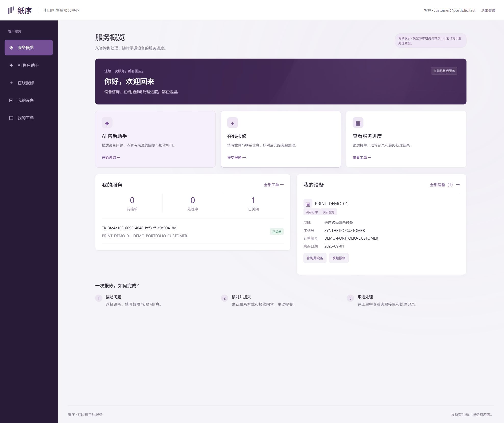
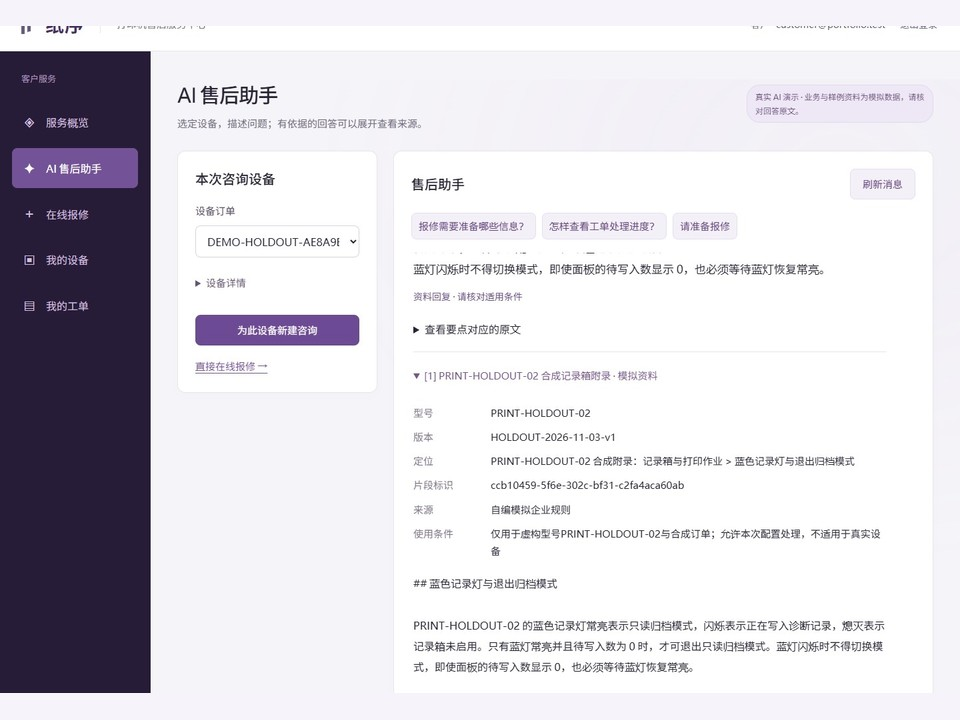
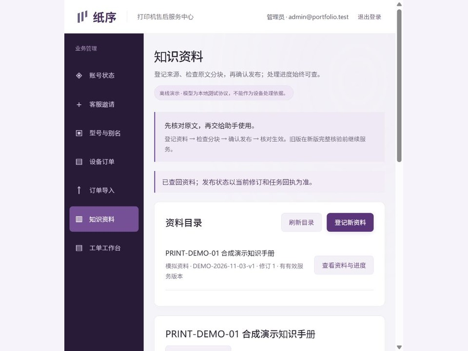
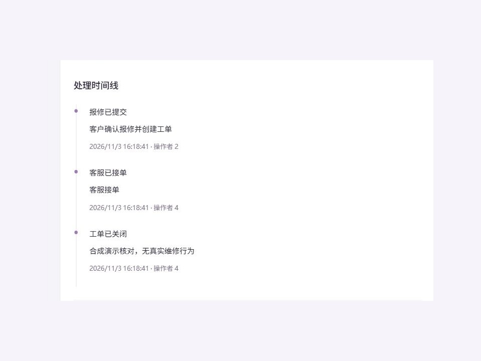
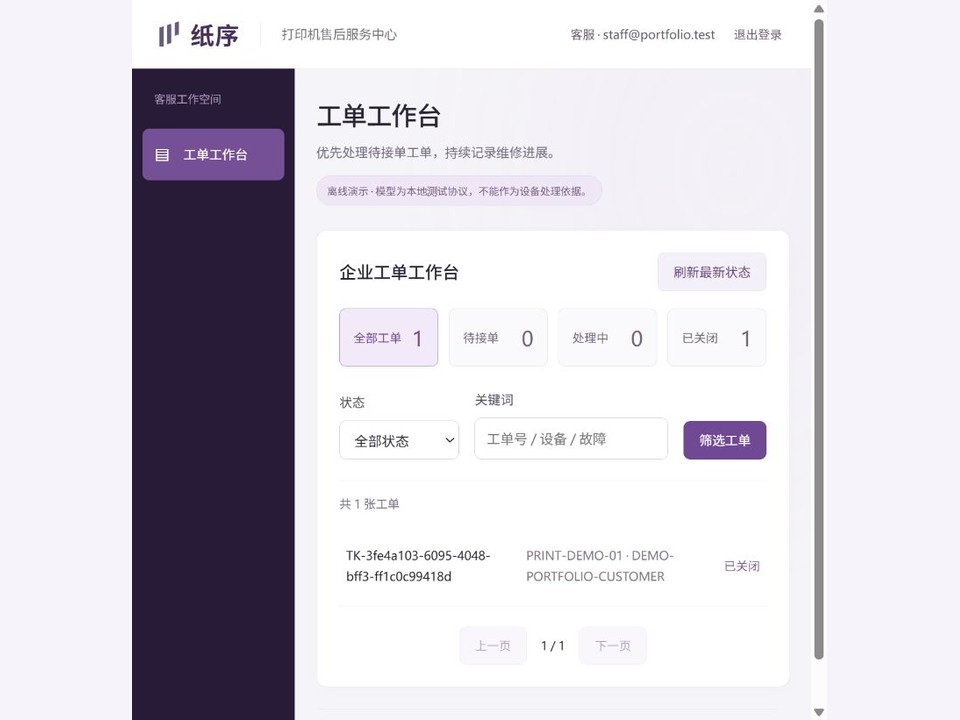
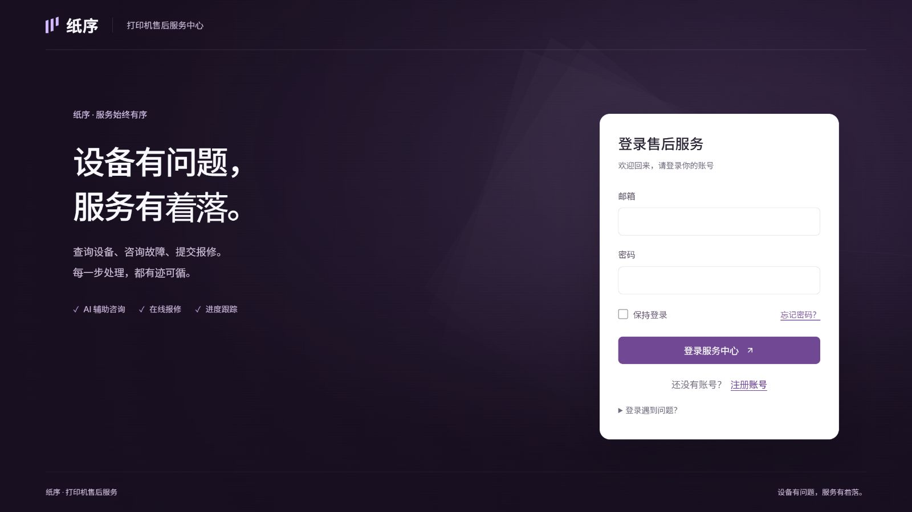

<div align="center">


<h1>纸序 · 打印机售后助手</h1>

<p><strong>有据可查的 AI 咨询，有迹可循的工单服务。</strong></p>

<p>从设备咨询到确认报修，再到客服处理与进度查回的 Java RAG 应用。</p>

<p>
  <a href="https://www.oracle.com/java/technologies/downloads/#java17"></a>
  <a href="https://spring.io/projects/spring-boot"></a>
  <a href="https://docs.langchain4j.dev/"></a>
  <a href="https://qdrant.tech/"></a>
  <a href="LICENSE"></a>
</p>

<p>
  <a href="#运行截图">运行截图</a> ·
  <a href="#功能">项目功能</a> ·
  <a href="#快速启动">快速启动</a> ·
  <a href="docs/architecture.md">架构说明</a> ·
  <a href="docs/evaluation.md">评测记录</a>
</p>

<p>
  作者：<a href="https://github.com/dashstar22">dashstar22</a> &nbsp;·&nbsp;
  QQ 邮箱：<a href="mailto:1025073706@qq.com">1025073706@qq.com</a>
</p>

</div>

---

## 项目介绍

一个可在本机复现的 Java AI 应用项目，把“查看设备 → 查阅资料 → 确认报修 → 客服处理 → 查询结果”连成完整流程。

项目侧重 RAG 与售后业务的连接：知识回答附带可展开的来源引用，用户确认报修内容后创建工单，客服处理过程通过时间线反馈给客户。AI 服务不可用时，仍可通过普通表单报修。

这是一个使用 AI 辅助开发的个人学习与作品展示项目，随仓库提供的设备、订单和知识样例均为合成演示数据。

## 运行截图

以下为项目实际运行截图：AI 回答图展示真实模型生成并保存的回答与引用，其余页面来自公开源码的离线演示实例。点击图片可查看完整原图。

<p align="center">
  <a href="docs/images/customer-overview.jpg"></a>
  <br />
  <sub>客户服务首页 · 从设备咨询到报修进度</sub>
</p>

<table>
  <tr>
    <th width="50%">有来源的 AI 回答</th>
    <th width="50%">知识资料管理</th>
  </tr>
  <tr>
    <td><a href="docs/images/ai-answer-with-citation.jpg"></a></td>
    <td><a href="docs/images/knowledge-management.jpg"></a></td>
  </tr>
  <tr>
    <td align="center">查看回答依据、适用条件和完整原文</td>
    <td align="center">登记资料，核查分块，确认发布与生效</td>
  </tr>
  <tr>
    <th>客户工单时间线</th>
    <th>客服工单工作台</th>
  </tr>
  <tr>
    <td><a href="docs/images/customer-ticket.jpg"></a></td>
    <td><a href="docs/images/staff-workbench.jpg"></a></td>
  </tr>
  <tr>
    <td align="center">报修内容、负责人和处理结果持续可查</td>
    <td align="center">待接单、处理中、已关闭状态清晰可见</td>
  </tr>
</table>

<details>
  <summary>查看登录页面</summary>
  <p align="center"><a href="docs/images/service-login.jpg"></a></p>
</details>

## 功能

- **客户服务**：邮箱验证注册、登录与找回密码，查询本人设备，通过对话或普通表单整理报修内容，确认后提交工单，补充文字和私有照片，查看处理时间线。
- **客服工作台**：接单、追加处理记录和关闭工单；关联咨询保留建单时的上下文和引用，避免重复描述。
- **业务管理**：邀请客服、维护标准型号和别名、核实设备归属、CSV 导入预检与确认。
- **知识管理**：上传文本、PDF、DOCX、Markdown 或 FAQ，检查分块，异步发布、重试与停用；新版本双索引核验通过后才替换旧版本。
- **报修信息收集**：默认启用受限语义理解，对自由文本和标签字段区分可填信息、知识问题、无关内容与不明确表达；服务端复核后才应用用户原文，关闭或分类失败时保持字段并澄清。需要有效 AI 配置，配置与边界见 [收集内容受限语义](docs/collection-semantics.md)。
- **有据问答**：型号和有效版本过滤，向量与 BM25 双路召回，RRF 融合及重排，展示来源与原文；区分无依据、需要补充信息和服务故障。
- **邮件与通知**：支持账号验证邮件，通过 MCP 提供只读查询，配合 n8n 和 Java 受控发送流程发送超时提醒与日报。本机演示默认使用 Mailpit 收件；外部 SMTP 和飞书通知可按 [邮件与自动化](docs/automation.md) 独立配置。
- **安全与可靠性**：服务端权限与数据归属校验、确认快照、幂等建单、候选缓存复核、限流、模型调用预算及审计；提供 HTTPS 部署、加密备份与恢复脚本。

## 技术栈与结构

Java 17 · Spring Boot · Spring Security · MyBatis · Flyway · LangChain4j · MySQL · Qdrant · Lucene · Redis · RabbitMQ。前端为原生 JavaScript ES Modules，无需 Node.js 构建。

```text
浏览器（客户 / 客服 / 管理员）
                │ HTTP + Session + CSRF
          Spring Boot 单体应用
           ├─ 账号、设备、报修与工单 ── MySQL
           ├─ 知识任务 / Outbox ── RabbitMQ
           ├─ 检索 ── Qdrant + Lucene ── RRF ── 重排
           ├─ 候选缓存与限流 ── Redis
           └─ 证据上下文 ── 聊天模型 ── 回答与引用校验
```

模块职责、核心链路和故障处理见 [架构说明](docs/architecture.md)。

## 快速启动

准备 **Java 17、Maven 3.9+、Python 3.10+、Docker 与 Compose v2**，并启动 Docker。建议至少预留 4 GB 可用内存。以下命令在仓库根目录执行；Windows PowerShell 可将 `mvn` 写为 `mvn.cmd`。

```sh
mvn -B -ntp -f backend/pom.xml package
python -X utf8 scripts/portfolio_runtime.py init --mode offline --instance my-offline-demo
python -X utf8 scripts/portfolio_runtime.py publish-sample --instance my-offline-demo
python -X utf8 scripts/portfolio_runtime.py start --instance my-offline-demo --open
python -X utf8 scripts/portfolio_runtime.py accounts --instance my-offline-demo
```

初始化会创建独立 Compose 项目、随机密码、客户／客服／管理员账号及演示设备，所有端口仅绑定本机。应用地址由启动输出给出，账号页在本机打开。每个实例使用唯一名称；已有实例可直接通过 `start` 重新启动。

**离线模式**无需模型密钥，使用本地模拟的向量与重排服务，适合体验知识发布、普通表单报修和工单处理。该模式不生成 AI 回答；需要模型判断的对话收集会保守澄清，可改用普通报修入口。

**真实 AI 模式**接入 DashScope `qwen-plus`、`text-embedding-v4`（1024 维）及 `qwen3-rerank`，需要自己的有效密钥，并会产生供应商用量：

```sh
# 先复制 deploy/portfolio/real.env.sample 到 .local-validation/real.env 并填写密钥
python -X utf8 scripts/portfolio_runtime.py init --mode real --instance my-real-demo --config .local-validation/real.env
python -X utf8 scripts/portfolio_runtime.py publish-sample --instance my-real-demo
python -X utf8 scripts/portfolio_runtime.py start --instance my-real-demo --open
python -X utf8 scripts/portfolio_runtime.py accounts --instance my-real-demo
```

两种模式使用独立实例，账号邮件均由 Mailpit 在本机接收，外部通知默认关闭。真实 AI 模式的默认日调用限额为 120 次、输入 UTF-8 字节限额为 1,200,000；实际费用以供应商计费为准，配置方法见 [运行手册](docs/running.md)。

示例问题：“PRINT-DEMO-01 显示 E17 时我应该怎么处理？”；资料未覆盖示例：“这台设备如何连接 Wi-Fi？”。

停止应用和依赖并保留数据：

```sh
python -X utf8 scripts/portfolio_runtime.py stop --instance my-offline-demo --dependencies
```

完整配置、邮件操作、重新启动和升级说明见 [运行手册](docs/running.md)。本机启动流程已在 Windows 验证；独立部署的 HTTPS、邮件及备份配置见 [部署说明](docs/deployment.md)。

## 验证与评测

以下汇总工程验证、检索与受限语义回归结果。各项保留独立的日期、版本和环境，详细范围见 [验证记录](docs/verification.md)。

| 验证项目 | 结果与范围 |
|---|---|
| 快速回归（2026-11-03） | 344 通过、0 失败、36 项需专用环境而跳过；专项集成验证见评测说明 |
| 真实 AI 业务流程（2026-11-03） | 初始化、样例发布、有据与无依据问答、确认报修、幂等建单、客服关闭、客户查询及重启后数据保留通过 |
| QQ 邮件（2026-11-02，指定候选版本） | 发送与实收均为 7 封，覆盖绑定、找回、注册及客服邀请，邮件链接操作通过 |
| 飞书通知（2026-11-02，指定候选版本） | MCP → n8n → Java → 飞书测试群，超时提醒与日报各 1 条，实收确认通过 |
| 隔离部署与恢复（2026-11-02，指定候选版本） | 19 项部署、故障、加密备份及空目标恢复检查通过，包含 10 项 MySQL 调用预算测试 |
| 40 问检索回归，三种配置对照 | ACC 组 RRF + 重排：必要语义单元覆盖@5 **77.45%**，MRR@5 **0.7765**，完整证据覆盖 **11/17** |
| 受限现场语义（2026-11-08） | 已见 36 题分类回归匹配 **34/36**，危险 FACT 提议 **0/24**；另有 6 个真实 HTTP/MySQL 业务场景通过，分类偏差与业务结果分开记录，见 [专项说明](docs/evaluation.md#等待-extra-的受限语义分类2026-11-08) |
| 收集内容受限语义（2026-11-09） | 默认开启调整后的已有单元／本机协议记录为 **607 PASS**；此前默认关闭的验收快照为23条真实分类＋1条本地门禁通过，另有8项隔离 HTTP/MySQL 通过，集成模型为协议替身；各自版本与范围见 [专项验证](docs/verification.md#收集内容受限语义专项2026-11-09) |
| 公开 8 问回归 | 当前记录的严格契约匹配结果为 **7/8**；题目、标注及执行器随仓库提供 |

**指标说明**：必要语义单元覆盖@5 是项目自定义的检索指标，衡量前五条结果对回答所需证据的覆盖程度；MRR@5 衡量首个相关片段的排名。完整证据覆盖 11/17 表示 ACC 组 17 个可答问题中，有 11 个的必要证据被全部覆盖。评测配置、计算方法与完整对照见 [评测说明](docs/evaluation.md)。

公开复现可使用仓库中的 CC0 样例与 8 问回归集。40 问检索回归使用受分发限制的厂商资料，公开内容为结果摘要与评测方法。

外部通知模板与部署恢复脚本随仓库提供，使用前需配置相应凭证和独立环境，详见 [邮件与自动化](docs/automation.md) 和 [部署说明](docs/deployment.md)。

本地回归入口：

```sh
python -X utf8 scripts/regression.py quick
python -m unittest discover -s scripts -p test_portfolio_runtime.py
# 独立中间件集成回归：需 Docker，会创建新容器，结束后停止并保留数据
python -X utf8 scripts/regression.py middleware
```

以上回归使用本地模拟服务，无外部模型调用。历史专用 `*IT` 中仍有依赖旧收集前置流程、尚待迁移的场景，不能将其历史结果视为当前全部集成通过。真实模型评测与测试范围见 [评测说明](docs/evaluation.md)。

## 目录

```text
backend/                  Spring Boot 应用、页面、数据库迁移与测试
scripts/                  隔离运行器和回归入口
deploy/portfolio/         本机依赖及真实 AI 配置样例
deploy/linux/             独立部署、HTTPS、备份与恢复脚本
automation/n8n/            手动触发的通知模板（默认停用）
samples/portfolio/        自编 CC0 演示资料
validation/product-portfolio-holdout/  公开 8 问回归集与执行器
validation/observation-semantics*/   受限语义固定集与受控评测适配器
docs/                     架构、运行与评测说明
```

## 联系作者

欢迎交流 Java、RAG 与 AI 应用开发，也欢迎通过 [Issues](https://github.com/dashstar22/printer-after-sales-assistant/issues) 反馈复现问题。

- GitHub：[dashstar22](https://github.com/dashstar22)
- QQ 邮箱：[1025073706@qq.com](mailto:1025073706@qq.com)

## 许可

自有源码按 [MIT License](LICENSE) 开源。第三方前端资源保留原许可与来源记录，见 [第三方说明](THIRD_PARTY_NOTICES.md)。合成样例与冻结题使用各自目录内的 CC0-1.0 声明。厂商名称、商标及用户另行导入的资料不因此获得许可；演示资料不提供真实维修或厂商服务承诺。
