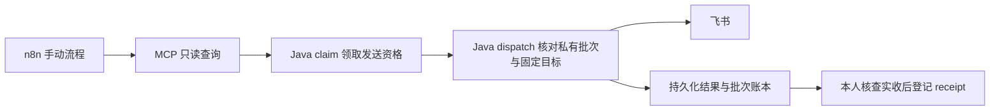

# 账号邮件、MCP 与可选通知

本机运行器始终使用 Mailpit 收取账号邮件，默认关闭外部通知；选择真实 AI 模式也不改变这一点。项目此前已通过 QQ SMTP 7 封、飞书测试群 2 条实收验收，版本和范围见 [验证记录](verification.md)。

## 账号邮件

应用通过 SMTP 发送绑定、找回、注册和邀请邮件。Mailpit 是本地 SMTP 接收器，不读取 QQ 收件箱。账号流程仍执行一次性链接、过期、冷却、配额及旧凭据失效检查。

独立部署的配置键为 `EMAIL_ENABLED`、`EMAIL_SMTP_HOST`、`EMAIL_SMTP_PORT`、`EMAIL_SMTP_USERNAME`、`EMAIL_SMTP_PASSWORD`、`EMAIL_FROM`、`EMAIL_SITE_ORIGIN`、`EMAIL_SMTP_STARTTLS`、`EMAIL_SMTP_SSL`。部署环境将密码放在私有 secret 文件，由入口脚本读取。QQ 历史验收采用 `smtp.qq.com:465`、`SSL=true`、`STARTTLS=false`，使用 SMTP 授权码；它不是 QQ 登录密码。587 STARTTLS 与 465 隐式 TLS 是不同配置，不能同时启用。

外部邮件链接使用准确的 HTTPS origin，包含实际非默认端口；不能把合成 `.test` 账号当作真实可投递邮箱。`SMTP_ACCEPTED` 只表示服务器接收，实收仍需核查。外部邮件需要独立部署配置和明确收件范围；本机运行器不提供切换外发模式的快捷参数。

## MCP 只读查询与通知写入

MCP `POST /mcp` 提供 `list_overdue_tickets`、`get_service_summary` 两个固定工具。前者按游标查询超时工单；后者返回上海时区指定日新建工单的当前状态计数，不重建历史时点状态。输出不含客户联系方式、照片或咨询正文。

服务使用独立 Bearer 身份、Host/Origin 约束及最小字段。`automation:read` 与 `notification:write` 凭证分开；不能使用浏览器 Cookie 代替服务凭证。凭证创建/撤销入口为应用命令 `--automation-credential-create`、`--automation-credential-revoke`，配置键及环境来源需结合 `AutomationCredentialCommand.java`、`IntegrationCredentials.java` 核对，秘密不写命令参数或公开文件。

通知路径如下：

领取接口为 `POST /api/integrations/notification-deliveries/claim`，受控发送接口为 `POST /api/integrations/notification-deliveries/{id}/dispatch`。Java 重新核对事件/工单版本，构造最小消息，并从私有策略读取目的地址；n8n 不持有 webhook，也不把正文或目标 URL 传给发送接口。Java 完成结果记账，模板不再调用旧的直接 webhook 或单独 Record result 节点。

## 导入模板及配置范围

使用 [超时模板](../automation/n8n/controlled-overdue.json) 和 [日报模板](../automation/n8n/controlled-summary.json)。二者由历史受控验收使用的转换逻辑导出：`active=false`，仅 Manual 入口，无 Schedule、无自动重试、不保存节点执行数据。历史验证使用 n8n 2.45.7；本轮只做静态契约与离线节点核验，未重新导入正在运行的 n8n。

导入后保持停用，需要分别完成：

1. 在独立 Java 环境配置 `AUTOMATION_ENABLED`、精确的 `AUTOMATION_ALLOWED_HOSTS` / `AUTOMATION_ALLOWED_ORIGINS`、`AUTOMATION_SITE_URL`、`AUTOMATION_ENABLED_TARGETS`。默认部署模板仍关闭自动化，需要单独的私有 Compose override。
2. 在 n8n 中创建加密 Bearer credentials，将 `CONFIGURE_AUTOMATION_READ` 和 `CONFIGURE_NOTIFICATION_WRITE` 替换为当前凭证引用。私有运行环境提供 `AFTER_SALES_APP_URL`、`AFTER_SALES_TARGET_ID`、`AFTER_SALES_AUTOMATION_ENABLED`，可选 `AFTER_SALES_PAGE_SIZE`；允许节点读取环境的设置需按当前 n8n 版本配置。不要把凭证值放入 JSON。
3. 将模板 Notify 节点中的 `CONFIGURE_OVERDUE_STEP_ID` / `CONFIGURE_SUMMARY_STEP_ID` 换为本次私有策略的准确 step ID。Java 端还需要 `CONTROLLED_DISPATCH_REQUIRED=true`、`CONTROLLED_DISPATCH_POLICY`、`CONTROLLED_DISPATCH_POLICY_SHA256`、`CONTROLLED_DISPATCH_LEDGER`、`CONTROLLED_DISPATCH_INSTANCE`、`CONTROLLED_DISPATCH_RESOURCE_ID` 和 `CONTROLLED_DISPATCH_ARTIFACT_SHA256`；策略包含新批次、包哈希、实例绑定、有效期、固定目标、步骤与额度。模板不生成批准策略，也不携带历史已消费的账本或授权。
4. 手动执行一次，检查 Java 结果与实际收件。管理员通过 `/api/admin/controlled-dispatch/receipt` 登记实收引用，再推进下一步；失败或 UNKNOWN 时停止核查，不能自动重发。接口需要管理员会话及 CSRF。结束后调用 `/api/admin/controlled-dispatch/stop`，撤销写凭证并保持流程停用。

历史的两个只读工具有协议与 SQL 对照证据，两个实收消息有单独回执。公开模板仍需自行部署、配置和验收，导入成功不代表具备外发条件；缺策略、过期、步骤不匹配、未核查前次实收都会被门禁拒绝。普通客户报修不依赖 MCP/n8n 可用。
